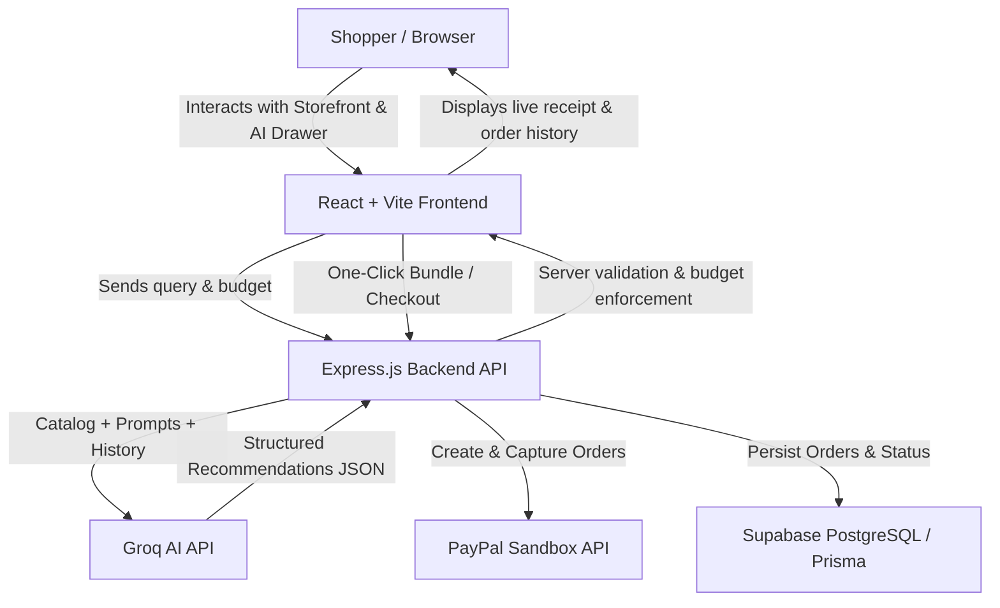

# Commerce Lead AI 🛒🤖

> **Intelligent, budget-aware AI shopping with verified PayPal checkout.**  
> Powered by **Groq AI**, **React + Vite**, **Node.js**, **Supabase (PostgreSQL)**, and **PayPal Sandbox**.

---

## 💡 The Problem & The Solution

**The Problem:** Traditional e-commerce search leaves shoppers with tab fatigue. Shoppers looking for a "work-from-home setup under $120" or "travel essentials" must manually search across categories, calculate bundle prices, and guess which products complement each other.

**The Solution:** **Commerce Lead AI** turns e-commerce into a smart, consultative conversation. Shoppers speak naturally, state their needs or budget, and receive:
1. **Curated product recommendations** tailored to their query.
2. **"Why this fits" explainability** explaining the logic behind every recommended item.
3. **A visual budget tracker** showing total cost, percentage of budget spent, and remaining balance.
4. **Atomic one-click bundle purchasing** to add all recommended items to the cart simultaneously.
5. **Verified PayPal Sandbox checkout** backed by server-side price validation, double-capture protection, and instant digital receipts.

---

## 🌟 Key Features

- **🤖 Conversational AI Assistant:** Fast, low-latency reasoning powered by Groq API (`openai/gpt-oss-20b`) with multi-turn conversation memory.
- **🛡️ Server-Grounded Catalog Resolution:** The AI cannot hallucinate prices or nonexistent items; every recommended ID is matched against the authoritative server catalog.
- **💰 Strict Budget Guardrails:** Backend enforcement trims over-budget items so bundle totals never exceed the shopper's stated budget limit.
- **🏷️ Explainable Recommendations:** Every card features a "Why this fits" badge highlighting why the product matches the shopper's intent.
- **📦 Atomic Bundle Purchasing:** "Add Complete Bundle to Cart" adds all recommended products in a single cart update with instant 2-second visual feedback.
- **💳 Robust PayPal Sandbox Checkout:** Real PayPal Smart Payment Buttons, server-side order creation (`/api/orders/create`), and secure capture (`/api/orders/capture`).
- **🔒 Idempotent Payment Capture & Recovery:** Safeguards against duplicate captures from rapid double-clicks or unstable connections.
- **🗄️ Supabase Persistence:** Order history and capture receipts stored in PostgreSQL via Prisma ORM.
- **🧪 24 Passing Automated Tests:** Full backend regression suite covering budget caps, payment recovery, order creation, and conversation history limits.

---

## 🏛️ System Architecture



---

## 🚀 Quickstart & Local Setup

### Prerequisites
- **Node.js** (v18+ recommended) & **npm**
- **Groq API Key** ([console.groq.com](https://console.groq.com))
- **PayPal Developer Account** ([developer.paypal.com](https://developer.paypal.com)) with Sandbox Client ID & Secret
- **Supabase Database** (or PostgreSQL instance)

### 1. Backend Setup

```bash
cd backend
npm install

# Copy environment template and fill in your credentials
cp .env.example .env

# Generate Prisma client and run migrations
npx prisma generate
npx prisma migrate deploy

# Start backend server (runs on http://localhost:3000)
npm run dev
```

#### Backend Environment Variables (`backend/.env`)
| Variable | Description |
| :--- | :--- |
| `PORT` | Backend server port (default: `3000`) |
| `DATABASE_URL` | Supabase / PostgreSQL pooled connection string |
| `DIRECT_URL` | Direct connection string for Prisma migrations |
| `PAYPAL_CLIENT_ID` | PayPal Sandbox App Client ID |
| `PAYPAL_CLIENT_SECRET` | PayPal Sandbox App Secret |
| `PAYPAL_CURRENCY` | Currency code (default: `USD`) |
| `GROQ_API_KEY` | Groq API access token |
| `GROQ_MODEL` | Groq model identifier (e.g. `openai/gpt-oss-20b`) |

### 2. Frontend Setup

In a separate terminal:

```bash
cd frontend
npm install

# Copy environment template and configure PayPal Client ID
cp .env.example .env

# Start Vite dev server (runs on http://localhost:5173)
npm run dev
```

#### Frontend Environment Variables (`frontend/.env`)
| Variable | Description |
| :--- | :--- |
| `VITE_PAYPAL_CLIENT_ID` | PayPal Sandbox Client ID (public) |
| `VITE_PAYPAL_CURRENCY` | Currency code (e.g. `USD`) |

---

## 🧪 Testing & Verification

### Run Backend Regression Tests (24/24 passing)
```bash
cd backend
npm test
```
Tests verify:
- Budget enforcement and item trimming on `/api/ai/recommend`.
- History truncation (capping conversation context at 10 turns and 500 characters per turn).
- Order creation with server-side price validation.
- Payment capture recovery and duplicate-capture prevention.

### Run Frontend Production Build
```bash
cd frontend
npm run build
```

---

## 🎬 Judge Demo Guide & Presentation Script

For hackathon judges and evaluators, see **[`DEMO_GUIDE.md`](./DEMO_GUIDE.md)** for:
- **2-Minute Elevator Pitch** explaining the problem, architecture, and business impact.
- **Step-by-Step Walkthrough** (from initial prompt `"Work-from-home setup under $120"` to completed PayPal Sandbox receipt).
- **Reliability & Security Highlights**.

---

## ⚠️ Limitations & Hackathon Scope

- **Sandbox Payments:** All payments are executed against PayPal Sandbox; no real currency is transferred.
- **Open Order History:** The `/api/orders` endpoint returns recent demo orders for storefront visibility without requiring customer authentication. In a production release, server-side JWT authentication would restrict access strictly to each authenticated customer's own orders.
- **Credential Safety:** All sensitive credentials (`GROQ_API_KEY`, `PAYPAL_CLIENT_SECRET`, database connection passwords) reside exclusively in backend environment variables and are excluded from version control.
